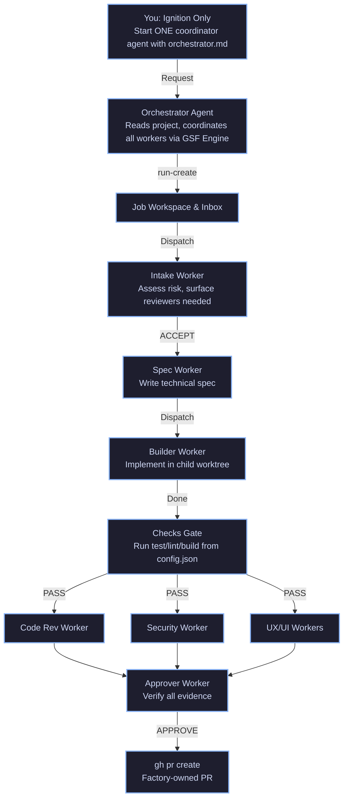

# Generic Software Factory (GSF)

An **issue-to-PR factory** that runs on autonomous agent orchestration.

**What this project is:** playbooks, role prompts, config, ledger, modular skills, rigorous engineering principles, and a complete markdown-first execution framework (`.gsf/`). You copy them into your product repository.

**What the GSF Runtime is:** The coordination layer where an orchestrator agent manages subagents (`worker-start`), executes modular skills (`.gsf/skills/`), and processes signals (`worker_done`).

**What you do:** install the runtime, configure checks, and **ignite one coordinator** with your request. You do not manually paste prompts into multiple UI agents or sit in the review loop.

---

## 📊 Visual Flow



---

## 🛠️ Installation & Setup on Any Machine

### 1. Copy the Factory into Your Product Repo
Clone or copy the `.gsf/` directory, `config.json`, and all `GSF_*.md` files directly into the root of the repository you want to develop:
```bash
cp -r GSF/.gsf /your/target/repo/
cp GSF/config.json /your/target/repo/
cp GSF/GSF_*.md /your/target/repo/
```

### 2. Configure Your Project (`config.json`)
Edit `config.json` to define your project's build, test, and lint commands:
```json
{
  "base_branch": "main",
  "checks": [
    "npm test",
    "npm run lint"
  ],
  "protected_paths": [
    "tests/**",
    "**/*.test.*"
  ],
  "autonomy": {
    "publish_pr": true,
    "merge_pr": false
  }
}
```

---

## 🚀 Worked Example: Creating a Login Screen

Suppose issue **#101** is filed on your repository:
> *Create a responsive Login Screen with email and password fields, form validation (empty fields and invalid email format), and error handling for failed authentication.*

### Step 1: Initialize the Run (The Only Human Step)
Trigger the orchestrator with your request.

### Step 2: Intake & Plan
The orchestrator triggers the Intake Agent to validate requirements and assess risk.

### Step 3: Specification
The Spec-Writer Agent produces `spec.md` with exact UI component layouts and state rules.

### Step 4: Builder & Checks Gate
The Builder Agent implements the Login Screen and corresponding tests, followed by the automated checks gate.
