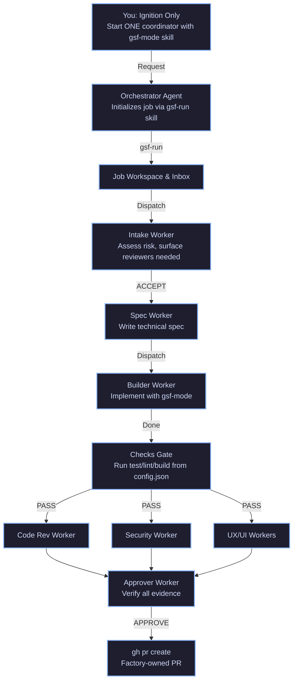

# Generic Software Factory (GSF)

An **issue-to-PR factory** that runs on autonomous agent orchestration with rigorous, markdown-first engineering skills.

**What this project is:** A complete markdown-first execution framework with rigorous skills, principles, playbooks, and agents (`.gsf/`). You copy them into your product repository.

**What the GSF Runtime is:** The coordination layer where an orchestrator agent manages subagents, executes modular skills (`.gsf/skills/`), and processes signals through a skill-based architecture.

**What you do:** Install the framework, configure checks, and **ignite one coordinator** with your request. You do not manually paste prompts into multiple UI agents or sit in the review loop.

---

## 📊 Visual Flow



---

## 🛠️ Installation & Setup on Any Machine

### 1. Copy the Factory into Your Product Repo
Clone or copy the `.gsf/` directory, `config.json`, and all `GSF_*.md` files directly into the root of the repository you want to develop:

```bash
cp -r GSF/.gsf /your/target/repo/
cp GSF/config.json /your/target/repo/
cp GSF/GSF_*.md /your/target/repo/
```

### 2. Configure Your Project (`config.json`)
Edit `config.json` to define your project's build, test, and lint commands:
```json
{
  "base_branch": "main",
  "checks": [
    "npm test",
    "npm run lint"
  ],
  "protected_paths": [
    "tests/**",
    "**/*.test.*"
  ],
  "autonomy": {
    "publish_pr": true,
    "merge_pr": false
  }
}
```

### 3. Initialize a Job Run
Invoke the **gsf-run** skill to initialize the job workspace and validate the environment. This replaces the previous script-based `run.sh`.

---

## 🚀 Worked Example: Creating a Login Screen

Suppose issue **#101** is filed on your repository:
> *Create a responsive Login Screen with email and password fields, form validation (empty fields and invalid email format), and error handling for failed authentication.*

### Step 1: Initialize the Run (The Only Human Step)
Invoke the **gsf-run** skill to validate the environment and create the job workspace. The orchestrator coordinates this automatically.

### Step 2: Intake & Plan
The orchestrator triggers the Intake Agent with the **gsf-mode** skill attached.
- **Intake**: Validates requirements, checks for ambiguities, assesses risk using **blast-radius**, and flags required review surfaces (`ui`, `security`). Produces `decision.md`.

### Step 3: Specification
The Spec-Writer Agent with **gsf-mode** and **investigation** playbook reads existing components and routing patterns, producing `spec.md` with exact UI component layouts, state management rules, validation logic, and test cases.

### Step 4: Builder & Checks Gate
The Builder Agent with **gsf-mode** and **feature** playbook creates a workspace branch, implements the Login Screen and corresponding unit/integration tests using **tdd** skill, and signals completion.
The orchestrator then executes the `checks` defined in `config.json` (e.g., `npm test`, `npm run lint`).
- If **PASS**: Proceeds to the parallel review wave.
- If **FAIL**: Bounces back to the builder with error logs.

### Step 5: Parallel Review Wave
Specialized reviewers (Code, Security, UI, UX) with **gsf-mode** and **interrogate** skill inspect the changes simultaneously in isolated read-only contexts:
- **Code Reviewer**: Audits component architecture and test coverage using **blast-radius**.
- **Security Reviewer**: Checks for credential exposure, secure password handling, and input sanitization applying **boundary-discipline**.
- **UI/UX Reviewers**: Validate responsiveness and design consistency against requirements applying **experience-first**.

### Step 6: Approval & Publication
The Approver Agent with **gsf-mode** reviews all accumulated evidence (`spec.md`, `build.md`, `checks.md`, review logs) and signs off (`APPROVE`).
If `publish_pr` is true, the factory automatically executes:
```bash
gh pr create --base main --head <builder-branch> --title "[Factory] Create Login Screen" --body "Implements responsive login screen with validation and error handling (#101)."
```

---

## 🧱 Core Architecture

### Skills (`.gsf/skills/`)
Modular markdown skill definitions for rigorous execution:
- **gsf-mode**: Main routing skill with 23 playbooks (bug-fix, feature, refactoring, perf-issue, etc.)
- **gsf-run**: Job workspace initialization and environment validation
- **architect**: Parallel design exploration with references/templates
- **arena**: N parallel candidates with base selection and grafting
- **how**: Architectural explanations for subsystems
- **why**: Motivation and intent investigation
- **interrogate**: Adversarial review for contested designs
- **blast-radius**: Impact assessment before changes
- **tdd**: Test-driven development
- **swarm**: Parallel workers across different slices
- **unslop**: Remove AI writing tells
- **technical-writing**: Diátaxis framework documentation
- **no-comments**: Self-documenting code
- **gsf-help**: Navigation assistance
- **24 Principles**: attack-the-premise, boundary-discipline, build-the-lever, encode-lessons-in-structure, exhaust-the-design-space, experience-first, explain-the-number, fix-root-causes, foundational-thinking, guard-the-context-window, laziness-protocol, make-operations-idempotent, migrate-callers-then-delete, minimize-reader-load, model-the-domain, never-block-on-the-human, outcome-oriented-execution, prove-it-works, redesign-from-first-principles, separate-before-serializing-shared-state, sequence-verifiable-units, subtract-before-you-add, test-behavior-not-implementation, type-system-discipline

### Playbooks (`.gsf/skills/gsf-mode/playbooks/`)
23 step-by-step operational playbooks:
- investigation, bug-fix, perf-issue, hillclimb, runtime-forensics, trace-forensics
- feature, refactoring, prototype, visual-parity
- authoring-a-skill, eval, babysit, shipping
- autonomous-run, orchestrate, autopilot-full, autopilot-stack
- session-pickup, pause-safely, multi-phase-plan, worktree-cleanup, opening-a-pr

### Agents (`.gsf/agents/`)
30 specialized roles with worker contracts:
- orchestrator, intake, spec-writer, builder, approver
- reviewer-code, reviewer-security, reviewer-ui, reviewer-ux
- db-specialist, api-contract, performance, i18n
- comment-reviewer, forensic-analyst, hillclimb-agent, poteto-agent, rigorous-delegate

### Principles
24 foundational engineering rules encoded as skills:
- Core: Laziness Protocol, Foundational Thinking, Redesign from First Principles, Attack the Premise, Subtract Before You Add, Minimize Reader Load, Outcome-Oriented Execution, Experience First, Exhaust the Design Space, Build the Lever
- Architecture: Model the Domain, Boundary Discipline, Type System Discipline, Make Operations Idempotent, Migrate Callers Then Delete, Separate Before Serializing Shared State
- Verification: Prove It Works, Fix Root Causes, Sequence Work into Verifiable Units, Test Behavior Not Implementation, Explain the Number
- Delegation: Guard the Context Window, Never Block on the Human
- Meta: Encode Lessons in Structure

---

## 📝 Key Features

### Zero Script Execution
All logic, playbooks, principles, and skills live in structured Markdown (`.md`). No `.sh`, `.py`, or `.js` runtimes. This makes the framework universally readable by any LLM harness.

### Deterministic Checklists
Formatted with explicit steps and strict constraints so models follow protocols reliably without drift.

### Rigorous Engineering
Built on 24 foundational engineering principles that ensure high-quality, maintainable code.

### Parallel Execution
Skills like **arena** and **swarm** enable parallel exploration and coverage for faster, more comprehensive work.

### Evidence-Based
Every action produces evidence in job workspaces. The approver verifies all evidence before publication.

---

## 🧱 Contributing & Creating New Agents

Every agent prompt in `.gsf/agents/` must strictly follow the **5 Pillars of the Perfect Prompt** framework:

1. **Role**: Define persona, seniority, and core domain expertise.
2. **Context**: Explain operational environment and upstream/downstream flows.
3. **Task**: Sequential step-by-step actions with skill attachments.
4. **Constraints**: Prohibited actions and safety guardrails.
5. **Format**: Exact output structures and expected artifacts.

All agents must attach the **gsf-mode** skill to ensure rigorous execution.

For detailed guidelines and templates, check [CONTRIBUTING_AGENTS.md](./CONTRIBUTING_AGENTS.md).

---

## 🗂️ Core Files Overview

| Path | Role |
|---|---|
| `GSF_FACTORY.md` | Coordinator runbook (Protocol DAG + Inbox/Outbox) |
| `.gsf/agents/` | Specialist agent role prompts (5 Pillars compliant) |
| `.gsf/skills/` | Modular markdown skills with playbooks and principles |
| `.gsf/skills/gsf-mode/` | Main routing skill with 23 playbooks |
| `.gsf/skills/gsf-mode/playbooks/` | Step-by-step operational procedures |
| `.gsf/jobs/` | Execution evidence ledger |
| `config.json` | Project policies, checks, and autonomy settings |
| `GSF_RIGOROUS_GUIDE.md` | Pure Markdown architecture documentation |

---

## 🚪 Exit Strategy (Migration)
If you decide to stop using GSF orchestration:
1. Move your source code to a clean directory structure.
2. Delete `.gsf/`, `config.json`, and all `GSF_*.md` files.
3. See `MIGRATION.md` for full cleanup steps.

---

## 📚 Additional Documentation

- **GSF_RIGOROUS_GUIDE.md**: Complete architecture guide for the markdown-first, low-model optimized framework
- **GSF_FACTORY.md**: Factory coordinator runbook
- **GSF_CONSTRAINTS.md**: Project-specific constraints and guardrails
- **CONTRIBUTING_AGENTS.md**: Guidelines for creating new agents
- **MIGRATION.md**: Migration and cleanup instructions
