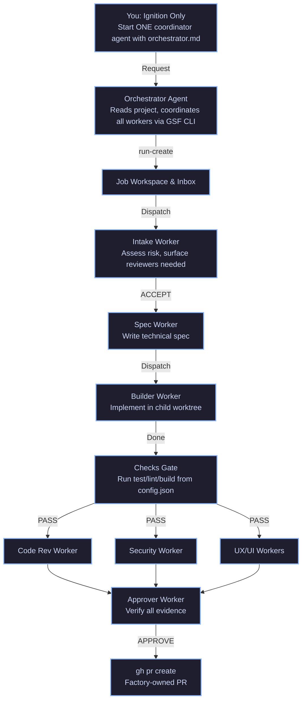

# Generic Software Factory (GSF)

An **issue-to-PR factory** that runs on autonomous agent orchestration.

**What this project is:** playbooks, role prompts, config, ledger, and modular skills (`.gsf/`). You copy them into your product repository.

**What the GSF Runtime is:** The coordination layer where an orchestrator agent manages subagents (`worker-start`), executes modular skills (`.gsf/skills/`), and processes signals (`worker_done`).

**What you do:** install the runtime, configure checks, and **ignite one coordinator** with your request. You do not manually paste prompts into multiple UI agents or sit in the review loop.

---

## 📊 Visual Flow



---

## 🛠️ Installation & Setup on Any Machine

### 1. Copy the Factory into Your Product Repo
Clone or copy the `.gsf/` directory, `config.json`, and all `GSF_*.md` files directly into the root of the repository you want to develop:

```bash
cp -r GSF/.gsf /your/target/repo/
cp GSF/config.json /your/target/repo/
cp GSF/GSF_*.md /your/target/repo/
```

### 2. Make Harness and Skills Executable
```bash
cd /your/target/repo
chmod +x .gsf/bin/*.sh
chmod +x .gsf/skills/*.sh
```

### 3. Configure Your Project (`config.json`)
Edit `config.json` to define your project's build, test, and lint commands:
```json
{
  "base_branch": "main",
  "checks": [
    "npm test",
    "npm run lint"
  ],
  "protected_paths": [
    "tests/**",
    "**/*.test.*"
  ],
  "autonomy": {
    "publish_pr": true,
    "merge_pr": false
  }
}
```

---

## 🚀 Worked Example: Creating a Login Screen

Suppose issue **#101** is filed on your repository:
> *Create a responsive Login Screen with email and password fields, form validation (empty fields and invalid email format), and error handling for failed authentication.*

### Step 1: Initialize the Run (The Only Human Step)
Run the GSF execution harness to validate the environment and create the job workspace:
```bash
./.gsf/bin/run.sh "101-login-screen: Responsive login form with validation"
```

### Step 2: Intake & Plan
The orchestrator triggers the Intake Agent.
- **Intake**: Validates requirements, checks for ambiguities, assesses risk, and flags required review surfaces (`ui`, `security`). Produces `decision.md`.

### Step 3: Specification
The Spec-Writer Agent reads existing components and routing patterns, producing `spec.md` with exact UI component layouts, state management rules, validation logic, and test cases.

### Step 4: Builder & Checks Gate
The Builder Agent creates a workspace branch, implements the Login Screen and corresponding unit/integration tests, and signals completion. 
The harness then executes the `checks` defined in `config.json` (e.g., `npm test`, `npm run lint`).
### 4. Automatic Environment Setup
The GSF includes a smart setup skill (`.gsf/skills/setup.sh`) that automatically detects project requirements (Node.js, npm, GitHub CLI). 
When you run `./.gsf/bin/run.sh`, the factory will:
- Verify your local environment dependencies.
- Automatically run `npm install` if a `package.json` is detected.
- Warn you if critical tools like `gh` (GitHub CLI) are missing for PR automation.

- If **PASS**: Proceeds to the parallel review wave.
- If **FAIL**: Bounces back to the builder with error logs.

### Step 5: Parallel Review Wave
Specialized reviewers (Code, Security, UI, UX) inspect the changes simultaneously in isolated read-only contexts:
- **Code Reviewer**: Audits component architecture and test coverage.
- **Security Reviewer**: Checks for credential exposure, secure password handling, and input sanitization.
- **UI/UX Reviewers**: Validate responsiveness and design consistency against requirements.

### Step 6: Approval & Publication
The Approver Agent reviews all accumulated evidence (`spec.md`, `build.md`, `checks.md`, review logs) and signs off (`APPROVE`). 
If `publish_pr` is true, the factory automatically executes:
```bash
gh pr create --base main --head <builder-branch> --title "[Factory] Create Login Screen" --body "Implements responsive login screen with validation and error handling (#101)."
```

---

## 🧱 Contributing & Creating New Agents

Every agent prompt in `.gsf/agents/` must strictly follow the **5 Pillars of the Perfect Prompt** framework:

1. **Role**: Define persona, seniority, and core domain expertise.
2. **Context**: Explain operational environment and upstream/downstream flows.
3. **Task**: Sequential step-by-step actions.
4. **Constraints**: Prohibited actions and safety guardrails.
5. **Format**: Exact output structures and expected artifacts.

For detailed guidelines and templates, check [CONTRIBUTING_AGENTS.md](./CONTRIBUTING_AGENTS.md).

---

## 🗂️ Core Files Overview

| Path | Role |
|---|---|
| `GSF_FACTORY.md` | Coordinator runbook (Protocol DAG + Inbox/Outbox) |
| `.gsf/agents/` | Specialist agent role prompts (5 Pillars compliant) |
| `.gsf/skills/` | Pluggable automation scripts (`validate.sh`, `setup.sh`) |
| `.gsf/bin/run.sh` | Main harness runner for environment bootstrap |
| `.gsf/bin/gsf.py` | Coordination CLI for state & logging |
| `.gsf/jobs/` | Execution evidence ledger |
| `config.json` | Project policies, checks, and autonomy settings |

---

## 🚪 Exit Strategy (Migration)
If you decide to stop using GSF orchestration:
1. Move your source code to a clean directory structure.
2. Delete `.gsf/`, `config.json`, and all `GSF_*.md` files.
3. See `MIGRATION.md` for full cleanup steps.
