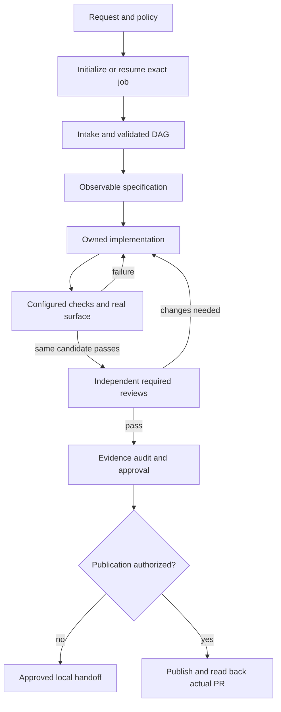

# Generic Software Factory (GSF)

A change-to-evidence workflow executed by a coding agent: classify impact, design, implement, verify, review and, only when separately authorized, release and observe the result. GSF ships **Markdown instructions and contracts only**: skills, role prompts, playbooks, templates, policy and durable job records. It has no bundled executable, daemon, dependency installer, scheduler or automatic plugin registration.

## Start

1. Copy the single `.gsf/` directory into the target repository, excluding private runtime data: jobs, logs, bug evidence and personal model preferences. Preserve the [legal notices](.gsf/THIRD_PARTY_NOTICES.md), existing product configuration and local customizations. GSF never merges policy into a generic application config.
2. Read [.gsf/GSF_CONFIG.md](.gsf/GSF_CONFIG.md). Policy **2.0.0** distinguishes `framework` verification from a `product` profile with actual project checks. Declare each check's effect and target; an executable command or configured check is not permission to deploy. Keep publication, merge and deploy denied until explicitly authorized. External environments default to an empty allowlist.
3. Ask your coding agent to read [gsf-setup](.gsf/skills/gsf-setup/SKILL.md) and the [host guide](.gsf/docs/hosts/README.md). Setup validates policy, records observed capabilities and target identities, and reports missing prerequisites without silently installing dependencies or weakening checks. Existing installations follow the [explicit upgrade procedure](.gsf/docs/upgrades/README.md); never reinterpret an in-flight job with new schemas.
4. Start one coordinator:

```text
Read .gsf/GSF_CONFIG.md, .gsf/agents/orchestrator.md and
.gsf/skills/gsf-mode/SKILL.md. Implement the requested issue,
preserve the configured constraints, run every configured check,
and obtain the required independent reviews. Do not publish,
merge or deploy unless the corresponding action is authorized.
```

For an explicitly read-only question, attach `gsf-mode` directly. That mode must not initialize files merely to answer the question. A factory investigation may write evidence only when that is part of its authorized job.

### Loading skills

`.gsf/skills/` is the canonical source, **not a universal host search path**. Attach/read the actual SKILL.md files, or register them through your host's documented mechanism before using slash commands. Cursor, Claude Code, Devin and other hosts do not share one registration directory or task API.

Filesystem and terminal access are needed for execution. UI proof needs actual UI controls; parallel workers need real delegation; GitHub effects need authenticated forge access. Missing capability is disclosed. Serial execution can replace permitted work partitioning, never required independent review.

### Classify the change, not just its files

The [impact matrix](.gsf/skills/gsf-mode/references/impact-matrix.md) connects each affected surface to an invariant, owner, resource scope and observable proof. A database migration, cloud change, asynchronous consumer and UI fix need different evidence. Missing tools or authority block the affected action; they do not justify a passing result or a fictional fallback.

## Workflow



Commit, publication, merge and deployment are distinct actions. Authorized local unit commits require their relevant checks; final readiness/publication requires complete current-candidate checks, independent reviews and approval. A later source edit invalidates affected evidence. Evidence-only appends do not change the implementation candidate.

## Policy and state

The canonical policy is `.gsf/GSF_CONFIG.md`; constraints are `.gsf/GSF_CONSTRAINTS.md`. All `config.paths` entries, check paths/working directories and protected paths resolve from the **repository root**, never from the policy file's `.gsf/` directory. There is no fallback to root-level policy files.

```text
README.md
.gsf/
  GSF_CONFIG.md
  GSF_FACTORY.md
  GSF_CONSTRAINTS.md
  CONTRIBUTING_AGENTS.md
  GSF_RIGOROUS_GUIDE.md
  THIRD_PARTY_NOTICES.md
  .gitignore
  docs/
  agents/
  skills/
  state/
  templates/
```

| Artifact | Responsibility |
|---|---|
| `.gsf/GSF_CONFIG.md` | Versioned policy: typed checks/effects/targets, environments, execution limits, evidence retention, reviewers and permissions |
| `.gsf/state/*-contract.md` | Format contracts with a canonical JSON Schema block and normative semantic rules |
| `.gsf/state/candidate-contract.md` | Source manifest, policy identity, evidence exclusions and snapshot freshness |
| `.gsf/state/environment-contract.md` | Observed host capabilities and target identity, freshness and evidence; not an authority grant |
| `.gsf/state/release-contract.md` | Source/build/artifact/config/target binding, authorized effects, rollout observations and recovery |
| `.gsf/state/models.md` | Optional local YAML model preferences; available host models only |
| `<jobs>/<job-id>/plan.md` | YAML DAG, task states and dispatch history |
| `inbox.md`, `outbox.md`, `dispatches/*/events.md` | Append-only Markdown event records with structured YAML envelopes |
| `dispatches/*/report.md` | Worker-owned real findings, verdict, provenance and evidence |
| `decisions.md` | Append-only decisions, reasons, evidence and superseding corrections |

Markdown is the file format, not a promise of automatic enforcement. A real host parser/validator can inspect structured blocks; relationship/authority/liveness checks still follow the normative contracts. Missing validation capability is blocked, not a visual guess presented as mechanical validation.

### Checks and permissions

Checks are explicit typed entries: a real command with its repository-relative working directory, or a skill with an actual repository-relative SKILL.md path. Each declares `effect` (`read`, `local-write`, `external-write` or `destructive`) and `target` (null for local work, otherwise the configured target ID). Inspect actual nested effects; metadata does not sandbox a command. Every assigned check must execute and produce evidence. A framework skill check is not permission to omit product tests.

- Required reviewers cannot be removed by intake. Surface reviewers are selected by actual impact and recorded with reasons.
- Protected paths require scoped authorization before writes. TDD or a skill invocation is not an override.
- Publication, merge and deployment default to false. An explicit operator exception must name the denied action and scope and be recorded before acting; generic autonomy is not an exception.
- No exception bypasses mandatory checks/reviews, branch protection, credentials or security safeguards.
- The accepted policy baseline is retained immutably in the job; a later edited policy cannot retroactively excuse a failure.
- External operations bind the observed account, region and resource scope to accepted policy and authentic scoped grants. `region: null` is only proven nonapplicability for a documented nonregional provider, never unknown identity or a way around regional checks. Separate worktrees do not isolate shared external resources.
- Artifact-only publication verifies exact registry endpoint/account/namespace/version and immutable content readback; it does not require deployment, traffic or service-health tools and does not claim deployed/healthy state. Environment deployment separately binds build/config/target and its rollout/recovery proof. PR, registry-publication and deploy authority are distinct.
- Execution limits are operator policy, not invented provider controls. Unknown cost is not zero cost; an unobservable required cap blocks the affected work. On actual quota or tool unavailability, checkpoint ownership and resume prerequisites without claiming an automatic wake.

## Choose a skill

| Need | Entry |
|---|---|
| Rigorous task routing | `gsf-mode` and its 23 playbooks |
| Setup, initialization, navigation | `gsf-setup`, `gsf-run`, `gsf-help` |
| Read a specific job's recorded progress without resuming | [gsf-status](.gsf/skills/gsf-status/SKILL.md); accepted evidence, freshness/liveness limits and next safe action, no writes |
| Architecture, rationale, teaching or prior context | `how`, `why`, `teach`, `recall` |
| Design alternatives / independent coverage | `architect`, `arena`, `swarm` |
| Adversarial review and change impact | `interrogate`, `blast-radius` |
| Real behavior verification | `tdd`, `control-ui`, `control-cli`, `create-verification-skill`, `maintain-verification-skill` |
| Bounded formal verification | `create-formal-verification-skill`, `maintain-formal-verification-skill`, `statechart` |
| Audit/catch-up | `show-me-your-work`, `ketchup`, `ketchup-video` |
| Authoring and communication | `create-skill`, `technical-writing`, `unslop`, `no-comments`, `bro`, `sharpen` |
| Working style and learning | `automate-me`, `correct`, `reflect`, `figure-it-out` |
| Language-specific discipline | `typescript-best-practices` when the product uses TypeScript |
| Infrastructure plans, drift, IAM, network and resource ownership | [cloud-change](.gsf/skills/cloud-change/SKILL.md) |
| Artifact-only registry publication or separately authorized environment rollout/recovery | [release](.gsf/skills/release/SKILL.md), with purpose-specific prerequisites and receipts |
| Trusted issue intake, deduplication and verification of existing fixes | [issue-triage](.gsf/skills/issue-triage/SKILL.md) |
| Incident coordination, authorized mitigation and handoff | [incident-response](.gsf/skills/incident-response/SKILL.md) |
| Data/restore, API/async, security/privacy, quality and accessibility | [domain-review](.gsf/skills/domain-review/SKILL.md) with existing specialists |
| Requirement–risk–proof mapping and evidence invalidation | [verification-strategy](.gsf/skills/verification-strategy/SKILL.md) |
| Verify this distribution | [verify-gsf](.gsf/skills/verify-gsf/SKILL.md) |
| Validate onboarding/quickstart docs as a consumer | [docs-drive](.gsf/skills/docs-drive/SKILL.md); exact documented steps, real outcomes and no hidden workaround |
| Upgrade a bounded dependency target safely | [dependency-upgrade](.gsf/skills/dependency-upgrade/SKILL.md); manager/lock scope, release guidance, actual consumers and recovery |
| Design synthetic data and independent expected results | [fixture-design](.gsf/skills/fixture-design/SKILL.md); tenant/time/schema boundaries, reproducible construction/reset and no production data |
| Diagnose unstable tests without retry-to-green | [flaky-test-investigation](.gsf/skills/flaky-test-investigation/SKILL.md); bounded comparable experiments, original failures and causal diagnosis |
| Resolve an ambiguous product problem before building | [feature-discovery](.gsf/skills/feature-discovery/SKILL.md); evidence/assumptions, no-build alternatives and bounded learning proposals, not a mandatory fix gate |
| Retire a feature without orphaned consumers/resources | [retire-feature](.gsf/skills/retire-feature/SKILL.md); inventory, reversible disablement, independent disposition authority and restore obligations |
| Compare changes to GSF instructions without inventing productivity gains | [evaluate-gsf](.gsf/skills/evaluate-gsf/SKILL.md); frozen tasks/oracles, isolated variants, independent grading, all outcomes and explicit adoption authority |
| Explore risky state combinations through an actual product surface | [exploratory-tester](.gsf/agents/exploratory-tester.md); independent bounded charter, adaptive driving, reproducible findings and separate app-state authority |
| Check whether the implementation actually solves the accepted consumer task | [product-reviewer](.gsf/agents/product-reviewer.md); independent outcome-fit review, real consumer evidence and no invented research/ROI gate |
| Locate a regression across exact versions without false historical blame | [regression-hunt](.gsf/skills/regression-hunt/SKILL.md); demonstrated endpoints, unclassified skips, bounded search and separate causal confirmation |
| Check whether selected tests actually detect meaningful defects | [mutation-check](.gsf/skills/mutation-check/SKILL.md); isolated requirement-linked mutations, relevant assertion kills, survivors and explicit inconclusive/excluded counts |
| Verify accepted version/platform/consumer compatibility promises | [compatibility-check](.gsf/skills/compatibility-check/SKILL.md); finite directional combinations, actual consumers and separate unsupported/untested/unknown coverage |
| Exercise a selected failure and real recovery safely | [failure-drill](.gsf/skills/failure-drill/SKILL.md); bounded owned injection, independent stop controls and separate delivery/degraded/recovered-state evidence |
| Find divergence between an accepted contract and observed behavior | [contract-drift](.gsf/skills/contract-drift/SKILL.md); normative precedence/version/direction, permitted extensions and static versus actual consumer findings |
| Test justified relationships when exact individual outputs are difficult | [metamorphic-testing](.gsf/skills/metamorphic-testing/SKILL.md); accepted domain relations, actual source/follow-up runs, frozen tolerances and replayable counterexamples |
| Model business-impacting threats before implementation | [threat-model](.gsf/skills/threat-model/SKILL.md); assets, actors, trust crossings, abuse scenarios, control/proof owners and authentic residual-risk decisions |
| Reconcile business records without trusting matching totals | [data-reconciliation](.gsf/skills/data-reconciliation/SKILL.md); accepted truth, tenant-qualified keys, snapshot/finality boundaries and independent semantic comparisons |
| Handle an explicitly authorized personal-data request | [privacy-request](.gsf/skills/privacy-request/SKILL.md); verified subject/tenant scope, least-data export, per-store deletion/hold evidence and restore-time suppression |
| Investigate a performance regression without treating noise as a bad revision | [performance-bisect](.gsf/skills/performance-bisect/SKILL.md); extends regression-hunt with accepted workloads, repeated measurements, uncertainty and conditional history search |
| Expose a feature separately from deploying its code | [feature-flag-rollout](.gsf/skills/feature-flag-rollout/SKILL.md); accepted eligibility/stable cohorts, both-state compatibility, actual metric gates and data-safe disablement |
| Adopt GSF without replacing an existing project's workflow | [gsf-adopt](.gsf/skills/gsf-adopt/SKILL.md); read-only workflow map, explicit conflicts and no-write proposal handed to the sole gsf-setup configurator |
| Challenge criteria before implementation without accepting intent for the owner | [acceptance-challenger](.gsf/agents/acceptance-challenger.md); independent measurability/consistency review with stage-appropriate proof |
| Review whether a service can actually be operated and recovered | [operability-reviewer](.gsf/agents/operability-reviewer.md); independent diagnosis, actionable alerts, stop/reconcile/resume and accepted recovery/capacity obligations |
| Review data meaning beyond valid schemas and matching counts | [data-quality-reviewer](.gsf/agents/data-quality-reviewer.md); independent units/null/time/identity/provenance analysis and honest population limits |
| Explain task-level role, skill and requested/effective model choices | [Routing/context operations](.gsf/docs/operations/context-memory.md); exact plan task IDs, observed capabilities, current-role preferences and explicit fallback limits |
| Prepare focused worker context without dropping obligations | [context-packet](.gsf/skills/context-packet/SKILL.md); five-pillar assignments, mandatory instruction loading, source-bound references and freshness |
| Reuse project facts without turning memory into policy | [project-memory](.gsf/skills/project-memory/SKILL.md); scoped sources, invalidation and separately authorized bounded curation |
| Design discriminating tests or author only assigned test paths | [test-engineer](.gsf/agents/test-engineer.md); independent oracle origins, explicit design/authorship mode and no substitute for real final checks |
| Resolve accepted native/platform risks | [platform-specialist](.gsf/agents/platform-specialist.md); finite target rows, actual drivers and explicit design versus runtime proof |
| Compose API/SDK/webhook work from existing procedures | [API pack](.gsf/packs/api.md); finite conditional selection, actual consumers and retained mandatory gates, not a configuration profile |
| Compose schema/backfill/semantic-data/recovery work | [Data pack](.gsf/packs/data.md); conditional storage, fixture, compatibility and independent semantic-quality procedures, not a policy profile |
| Compose infrastructure/IAM/network/operability work | [Cloud pack](.gsf/packs/cloud.md); exact provider/state/grants and conditional release/operability proof, with no implicit apply authority |
| Compose browser/desktop or CLI/TUI consumer journeys | [Interface pack](.gsf/packs/interface.md); accepted criteria, actual surface drivers and conditional independent UI/UX review, not a bundled renderer |
| Review accepted permissions and tenant/object enforcement | [authorization-review](.gsf/skills/authorization-review/SKILL.md); source-linked decision rows and explicit runtime-proof gaps |
| Review dependency/build/artifact trust claims | [supply-chain-review](.gsf/skills/supply-chain-review/SKILL.md); exact provenance, advisory scope and supported versus unknown claims |
| Review locale, fallback and localized consumer behavior | [localization-review](.gsf/skills/localization-review/SKILL.md); finite accepted locales, independent formatting settings and linguistic/runtime limits |
| Review diagnostic signal delivery and safety | [telemetry-review](.gsf/skills/telemetry-review/SKILL.md); bounded questions, actual correlation/receiver evidence and privacy/cost limits |
| Accept an exact bundle on an exact host/version | [plugin-acceptance](.gsf/skills/plugin-acceptance/SKILL.md); structural, installed/discovered and invoked observations remain separate, with separately authorized host changes |
| Add focused independent permission or artifact-trust review | Conditional [authorization-reviewer](.gsf/agents/authorization-reviewer.md) at `review-authorization.md` and [supply-chain-reviewer](.gsf/agents/supply-chain-reviewer.md) at `review-supply-chain.md`; stage-bound verdicts supplement mandatory code/security reviews |
| Compose threat, authorization, provenance and privacy work | [Security pack](.gsf/packs/security.md); conditional source-Markdown composition, not an executable exporter or permission profile |
| Prepare host-specific packages or review read-only evidence access | [Markdown package and evidence procedures](.gsf/docs/hosts/plugin-export.md); existing authorized tools, no auxiliary repository or bundled runtime, and no implied host installation |
| Review pagination without inventing snapshot guarantees | [pagination-review](.gsf/skills/pagination-review/SKILL.md); bounded traversal, independent membership/order evidence and cursor-scope boundaries |
| Review retry amplification and end-to-end budgets | [retry-budget-review](.gsf/skills/retry-budget-review/SKILL.md); total-attempt bounds, propagated deadlines and ambiguous-effect reconciliation |
| Review cache isolation, freshness and invalidation | [cache-correctness-review](.gsf/skills/cache-correctness-review/SKILL.md); response-varying key scope and bounded read/write timelines, not TTL or hit-rate assurance |
| Choose between adjacent skills without running them | [skill-selection](.gsf/skills/skill-selection/SKILL.md); finite use/do-not-use triggers, exact owners and separately approved external candidates |
| Establish third-party instruction, script and asset permission evidence | [license-dossier](.gsf/skills/license-dossier/SKILL.md); revision-bound reference/adapt/redistribute decisions and unresolved rights owners, not legal certification |
| Compare alternatives using bounded, cited evidence | [comparative-research](.gsf/skills/comparative-research/SKILL.md); revision-bound claims, explicit conflicts and conditional recommendations, not invented rankings or user research |
| Answer procurement questions without unsupported assurance claims | [procurement-evidence](.gsf/skills/procurement-evidence/SKILL.md); scoped question-to-artifact mapping, qualified answers, freshness and recipient-specific disclosure |
| Review streaming delivery, resource bounds and cancellation | [streaming-review](.gsf/skills/streaming-review/SKILL.md); source-bound framing, replay, backpressure and stop evidence, not inferred exactly-once effects or live transport proof |
| Triage supplier clauses without legal or purchasing authority | [supplier-contract-triage](.gsf/skills/supplier-contract-triage/SKILL.md); revision-bound commitments, missing annexes, technical mismatches and qualified human decisions |
| Prepare an accountable operational transfer | [operational-handover](.gsf/skills/operational-handover/SKILL.md); finite runbook journeys, recipient teach-back and authentic bounded acceptance, not document-upload sign-off |
| Turn meeting records into evidence-linked decisions and actions | [meeting-decision-trace](.gsf/skills/meeting-decision-trace/SKILL.md); exact attribution, disputed approvals, owner acknowledgment and date ambiguity without inferred sign-off |
| Explain configuration overrides without exposing secrets | [configuration-precedence-review](.gsf/skills/configuration-precedence-review/SKILL.md); version-bound per-key resolution, declared versus observed state and narrowly authorized evidence |
| Apply approved own-brand wording and supported identity rules | [approved-brand-identity](.gsf/skills/approved-brand-identity/SKILL.md); scoped approval, actual text changes, asset rights and explicit conflict/rendering limits |
| Turn authorized customer reports into evidence-linked candidate requirements | [customer-feedback-requirements](.gsf/skills/customer-feedback-requirements/SKILL.md); duplicate lineage, conflicting contexts, validation gaps and no invented priorities |
| Deliver documents with actual rendered inspection | [rendered-document-delivery](.gsf/skills/rendered-document-delivery/SKILL.md); exact editable/output identity, finite page coverage, observed corrections and separate rights/accessibility/publication |
| Review spreadsheet formulas and results against independent expectations | [spreadsheet-formula-review](.gsf/skills/spreadsheet-formula-review/SKILL.md); unit-aware dependencies, cache versus fresh calculation and explicit engine/coverage limits |
| Trace notebook analysis to data, transformations and authentic execution | [notebook-data-lineage](.gsf/skills/notebook-data-lineage/SKILL.md); immutable inputs/cells, observed profiles and independent result checks without fabricated kernel runs |
| Assess retrieval, answer support and insufficient-source behavior separately | [rag-product-evaluation](.gsf/skills/rag-product-evaluation/SKILL.md); pinned cases, source-linked judgments and explicit metric/evaluator limits without invented product quality |
| Reconcile PR review discussions against original closure conditions | [review-thread closure](.gsf/skills/gsf-mode/references/review-thread-closure.md) within babysit; complete thread/comment pagination, exact-head independent proof and separate reply/resolution authority |
| Correct obsolete documentation in bounded source-grounded units | [documentation-gardening](.gsf/skills/documentation-gardening/SKILL.md); preserve intentional history, migrate affected references and separate scoped edits from fresh-consumer proof and publication |
| Decide whether a linked worktree can be kept, archived or removed | [worktree-archive](.gsf/skills/worktree-archive/SKILL.md); actual liveness, dirty/index/untracked/ignored coverage and witnessed recovery before separately authorized non-force removal |
| Reconcile a pinned upstream source update without losing local intent | [upstream-sync](.gsf/skills/upstream-sync/SKILL.md); real three-way source mapping, explicit customization/conflict decisions, preserved notices and separately verified consumer behavior |
| Assess native WebMCP discovery and invocation within explicit browser authority | [webmcp-acceptance](.gsf/skills/webmcp-acceptance/SKILL.md); version-bound availability, exact document/origin/schema grants, effect-aware acceptance and explicit blocked native prerequisites |
| Reconcile orders and payment facts without moving money | [payment-reconciliation](.gsf/skills/payment-reconciliation/SKILL.md); authorized existing read routes or accepted receipts, qualified account/mode/currency partitions and separate capture/refund/fee/payout/settlement evidence |
| Deliver a recipient-readable index of change, outcomes, before/after proof and limits | [navigable-delivery](.gsf/skills/navigable-delivery/SKILL.md); exact existing evidence, actual bounded reading routes, permitted disclosure and no invented acceptance or publication |
| Review actual code, telemetry, audio and artifact destinations before enabling an integration | [data-residency-review](.gsf/skills/data-residency-review/SKILL.md); source versus effective routing versus observed transmission and physical copies, with required unknowns blocking only dependent enablement |
| Turn an evidenced procedure into a complete untrusted skill candidate | [experience-to-skill](.gsf/skills/experience-to-skill/SKILL.md); original before/fix/after evidence, independent expectations, reuse limits and separate curator acceptance, registration and effect authority |
| Determine who may propose, accept or distribute a skill change | [skill-curation-authority](.gsf/skills/skill-curation-authority/SKILL.md); version-bound authored/managed/adopted source, separate source/manager/publisher/consumer authority and retained license and frozen-job obligations |
| Assess reversible withdrawal from a named skill catalog without retiring content automatically | [skill-archive-proposal](.gsf/skills/skill-archive-proposal/SKILL.md); qualified use and consumer references, whole conditional patch, retained-byte recovery and exact return mapping, with low use never proving uselessness |
| Review exact repository, CI, contract, metric or trace evidence without installing a connector | [provider-evidence-review](.gsf/skills/provider-evidence-review/SKILL.md); existing scoped tools, complete attempts/pages, raw-versus-retained provenance and explicit native limits |
| Review personal, project and organization memory without crossing scope | [scope-memory-review](.gsf/skills/scope-memory-review/SKILL.md); explicit bindings, current native access, sourced facts and separate commissioning, with no automatic store creation |
| Review a full memory change before any application | [memory-change-proposal](.gsf/skills/memory-change-proposal/SKILL.md); exact complete before/proposed-after, original versions, line endings and full diff, always proposed and not applied |
| Bind memory acceptance to the exact original proposal and version | [memory-change-acceptance](.gsf/skills/memory-change-acceptance/SKILL.md); independent decision, actual native preconditions, durable intent/readback and no replay through unresolved effects |
| Reconstruct original memory mutations without reading today's target | [memory-mutation-history](.gsf/skills/memory-mutation-history/SKILL.md); complete accepted coverage, original declarations/material/receipts and explicit pending or missing effects |
| Refuse withdrawal of skill content with unresolved consumers | [referenced-skill-protection](.gsf/skills/referenced-skill-protection/SKILL.md); direct/transitive and frozen references, retained bytes and exact return routes, without claiming an OS deletion interceptor |
| Resolve competing worker write/effect ownership before reuse | [ownership-collision-review](.gsf/skills/ownership-collision-review/SKILL.md); concrete overlap, current native fences and no release through uncertain liveness |
| Distinguish a worker message from actual process state | [worker-liveness-review](.gsf/skills/worker-liveness-review/SKILL.md); exact owner/birth/session/time and separate completion, stop and acceptance |
| Confirm cancellation without guessing that effects stopped | [cancellation-confirmation](.gsf/skills/cancellation-confirmation/SKILL.md); scoped native acknowledgment, actual stop/readback and unresolved-effect quarantine |
| Assess five-domain checkpoint and recovery coverage | [checkpoint-coverage-review](.gsf/skills/checkpoint-coverage-review/SKILL.md); code, conversation, configuration, database and external state are independent |
| Reconcile a frozen persisted job before cold resume | [cold-resume-review](.gsf/skills/cold-resume-review/SKILL.md); original grants, owners, accepted events and every unresolved effect, without replay or silent refresh |
| Review pinned MCP initialization, complete listing and descriptor drift | [mcp-evidence-review](.gsf/skills/mcp-evidence-review/SKILL.md); exact transport/session/schema, full pages and no invocation from discovery |
| Review bounded raw evidence, SDK context and owned cleanup | [bounded-evidence-review](.gsf/skills/bounded-evidence-review/SKILL.md); native preallocation/parser/privacy/lifecycle prerequisites, not postdecode safety claims |
| Review actual deferred native tool disclosure | [progressive-tool-discovery](.gsf/skills/progressive-tool-discovery/SKILL.md); source-bound deterministic selection, complete schemas, matched calls/history and explicit unsupported-native blocks |
| Compare original contents-free MCP exchanges and trajectories | [mcp-exchange-review](.gsf/skills/mcp-exchange-review/SKILL.md); exact correlation/coverage and descriptive structures, not semantic equivalence or business effects |
| Reconcile exact usage facts without inventing billing | [usage-evidence-review](.gsf/skills/usage-evidence-review/SKILL.md); decimal units/cohorts, deduplication, cumulative epochs and missing meters |
| Select source-pinned reference, description and full context views | [context-view-review](.gsf/skills/context-view-review/SKILL.md); complete mandatory material, UTF-8 accounting and invalidation, not tokens/cache guarantees |
| Inspect explicitly approved inert code-loading roots | [loader-surface-review](.gsf/skills/loader-surface-review/SKILL.md); exact profile predicates and exclusions, no imports or activation inference |
| Review selected public CI privilege declarations | [ci-privilege-review](.gsf/skills/ci-privilege-review/SKILL.md); job replacement, unknown defaults and static findings, not effective-token certification |
| Compare independently pinned documentation and native evidence | [deprecation-evidence-review](.gsf/skills/deprecation-evidence-review/SKILL.md); exact claims and qualified stages, no automatic deprecation or upgrade |
| Plan small independently mergeable units | [small-pr-planning](.gsf/skills/small-pr-planning/SKILL.md); concrete ownership, full DAG, hypothetical waves and separately authorized exact-head publication |
| Separate built-in visibility from additional preapproval | [tool-control-review](.gsf/skills/tool-control-review/SKILL.md); exact historical profile, unchanged/empty/list arguments and no exclusive-permission or enforcement claim |
| Assess a complete version-bound skill union without losing consumers or rights | [skill-consolidation-map](.gsf/skills/skill-consolidation-map/SKILL.md); whole obligation/reference/variant coverage, full untrusted candidate and exact forward/return maps, or an explicit keep-separate decision |
| Commission a bounded automation without inheriting the current chat | [scheduled-job-commissioning](.gsf/skills/scheduled-job-commissioning/SKILL.md); explicit authority/expiry, timezone/DST/missed-run policy, separate occurrence/execution/delivery identity, hermetic context and effective model pin |
| Hand off to Hermes, Antigravity, Droid, Cline, OpenCode, Herdr or Herd | [documented native adapter procedures](.gsf/docs/hosts/README.md#additional-native-adapter-procedures); exact product/version/surface and canonical identity, no launchers or assumed installed support |
| Trace the complete Markdown-only migration and native prerequisites | [capability migration map](.gsf/docs/operations/markdown-capability-migration.md); all 37 implementation dispositions, 30 documentation dispositions and excluded executable/private artifacts |

The 24 principle skills remain unprefixed directories under `.gsf/skills/`. They guide decisions; they do not override policy. Media rendering and formal checkers require actual tools and have separate evidence requirements.

## Durable execution

The coordinator alone owns shared job state, the DAG, ledgers, policy decisions and canonical stage reports. Workers own their assigned product paths and dispatch-local reports/events. IDs are explicit: never infer a hyphenated job ID by splitting another identifier.

Resume reconciles intent, actual invocation receipts, complete worker events, accepted event history and report/plan projections before new effects. Unknown worker liveness blocks overlapping retries. Before retrying an interrupted publication, inspect actual forge state; a missing local receipt is not proof no PR was created.

The coordinator records observed environment capabilities and, for an operational release, the release state under their typed contracts. A merged PR, a queued deployment, a deployed artifact and a healthy user journey are distinct observations. Recovery may require roll-forward or data restoration rather than undoing code. Reports identify the supported action and its real result, never a guessed remote effect.

Keep evidence retrievable after cleanup under the accepted store, access and retention policy. A local path, digest or claimed expiry alone does not prove durable storage, authenticity or deletion. The [operations guide](.gsf/docs/operations/README.md) defines the retrieval and handoff procedure.

The [worker contract](.gsf/agents/WORKER_CONTRACT.md) is normative. Playbooks link it rather than duplicating global policy. Read-only direct use, factory investigations and implementation jobs have explicit applicability boundaries.

## Verification and boundaries

Run [verify-gsf](.gsf/skills/verify-gsf/SKILL.md) after changing the framework. Its [scenario matrix](.gsf/skills/verify-gsf/references/scenarios.md) covers format validation, real worker lifecycle, independent review, candidate identity, negative gates and interrupted-state recovery. Scratch products stay outside this repository and are never committed.

No count of files or absence of scripts proves autonomous reliability. Report the actual host, exercised scenarios and remaining capability limits. GSF instructions cannot guarantee atomic writes, process fencing, deterministic model behavior or exactly-once remote effects.

## Guides

- [First task, host setup and safe removal](.gsf/docs/guide/README.md)
- [Architecture and capabilities](.gsf/GSF_RIGOROUS_GUIDE.md)
- [Contributing roles and skills](.gsf/CONTRIBUTING_AGENTS.md)
- [Verification evidence](.gsf/docs/verification/README.md)
- [Host capabilities and adapters](.gsf/docs/hosts/README.md)
- [Policy and instruction upgrades](.gsf/docs/upgrades/README.md)
- [Operational limits, evidence and recovery](.gsf/docs/operations/README.md)

Only operational Markdown is distributed; `.gsf/.gitignore` is the explicit Git metadata exception. Its rules ignore jobs, logs, bug evidence and personal model preferences **within `.gsf/`**. They do not ignore repository-root `products/` or audit directories; keep scratch products outside the repository and manage any product-specific ignore rules separately.
