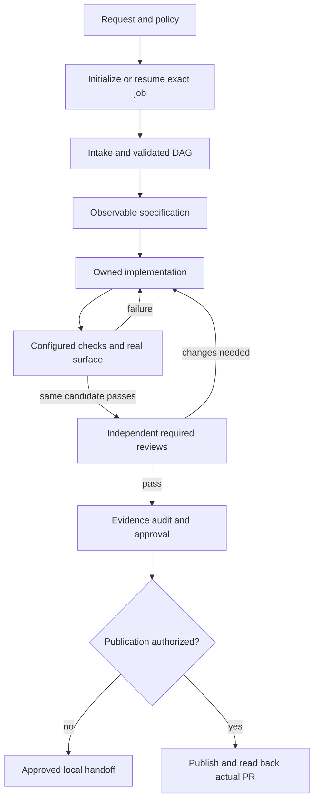

# Generic Software Factory (GSF)

An issue-to-PR workflow executed by a coding agent. GSF ships **Markdown instructions and contracts only**: skills, role prompts, playbooks, templates, policy and durable job records. It has no bundled executable, daemon, dependency installer, scheduler or automatic plugin registration.

## Start

1. Copy the single `.gsf/` directory into the target repository, excluding private runtime data: jobs, logs, bug evidence and personal model preferences. Preserve the [legal notices](.gsf/THIRD_PARTY_NOTICES.md), existing product configuration and local customizations. GSF never merges policy into a generic application config.
2. Read [.gsf/GSF_CONFIG.md](.gsf/GSF_CONFIG.md). The distributed `framework` profile verifies GSF itself through `verify-gsf`; it does not pretend there is an npm product in this repository. For product work, use the `product` profile and configure real project checks and working directories. Keep publication, merge and deploy denied until explicitly authorized.
3. Ask your coding agent to read [gsf-setup](.gsf/skills/gsf-setup/SKILL.md). It validates policy, discovers actual project/runtime/tool capabilities and reports missing prerequisites without silently installing dependencies or weakening checks.
4. Start one coordinator:

```text
Read .gsf/GSF_CONFIG.md, .gsf/agents/orchestrator.md and
.gsf/skills/gsf-mode/SKILL.md. Implement the requested issue,
preserve the configured constraints, run every configured check,
and obtain the required independent reviews. Do not publish,
merge or deploy unless the corresponding action is authorized.
```

For an explicitly read-only question, attach `gsf-mode` directly. That mode must not initialize files merely to answer the question. A factory investigation may write evidence only when that is part of its authorized job.

### Loading skills

`.gsf/skills/` is the canonical source, **not a universal host search path**. Attach/read the actual SKILL.md files, or register them through your host's documented mechanism before using slash commands. Cursor, Claude Code, Devin and other hosts do not share one registration directory or task API.

Filesystem and terminal access are needed for execution. UI proof needs actual UI controls; parallel workers need real delegation; GitHub effects need authenticated forge access. Missing capability is disclosed. Serial execution can replace permitted work partitioning, never required independent review.

## Workflow



Commit, publication, merge and deployment are distinct actions. Authorized local unit commits require their relevant checks; final readiness/publication requires complete current-candidate checks, independent reviews and approval. A later source edit invalidates affected evidence. Evidence-only appends do not change the implementation candidate.

## Policy and state

The canonical policy is `.gsf/GSF_CONFIG.md`; constraints are `.gsf/GSF_CONSTRAINTS.md`. All `config.paths` entries, check paths/working directories and protected paths resolve from the **repository root**, never from the policy file's `.gsf/` directory. There is no fallback to root-level policy files.

```text
README.md
.gsf/
  GSF_CONFIG.md
  GSF_FACTORY.md
  GSF_CONSTRAINTS.md
  CONTRIBUTING_AGENTS.md
  GSF_RIGOROUS_GUIDE.md
  THIRD_PARTY_NOTICES.md
  .gitignore
  docs/
  agents/
  skills/
  state/
  templates/
```

| Artifact | Responsibility |
|---|---|
| `.gsf/GSF_CONFIG.md` | One canonical YAML policy block: profile, checks, paths, reviewer policy and permissions |
| `.gsf/state/*-contract.md` | Format contracts with a canonical JSON Schema block and normative semantic rules |
| `.gsf/state/candidate-contract.md` | Source manifest, policy identity, evidence exclusions and snapshot freshness |
| `.gsf/state/models.md` | Optional local YAML model preferences; available host models only |
| `<jobs>/<job-id>/plan.md` | YAML DAG, task states and dispatch history |
| `inbox.md`, `outbox.md`, `dispatches/*/events.md` | Append-only Markdown event records with structured YAML envelopes |
| `dispatches/*/report.md` | Worker-owned real findings, verdict, provenance and evidence |
| `decisions.md` | Append-only decisions, reasons, evidence and superseding corrections |

Markdown is the file format, not a promise of automatic enforcement. A real host parser/validator can inspect structured blocks; relationship/authority/liveness checks still follow the normative contracts. Missing validation capability is blocked, not a visual guess presented as mechanical validation.

### Checks and permissions

Checks are explicit typed entries: a real command with its repository-relative working directory, or a skill with an actual repository-relative SKILL.md path. Every entry must execute and produce evidence. A framework skill check is not permission to omit product tests.

- Required reviewers cannot be removed by intake. Surface reviewers are selected by actual impact and recorded with reasons.
- Protected paths require scoped authorization before writes. TDD or a skill invocation is not an override.
- Publication, merge and deployment default to false. An explicit operator exception must name the denied action and scope and be recorded before acting; generic autonomy is not an exception.
- No exception bypasses mandatory checks/reviews, branch protection, credentials or security safeguards.
- The accepted policy baseline is retained immutably in the job; a later edited policy cannot retroactively excuse a failure.

## Choose a skill

| Need | Entry |
|---|---|
| Rigorous task routing | `gsf-mode` and its 23 playbooks |
| Setup, initialization, navigation | `gsf-setup`, `gsf-run`, `gsf-help` |
| Architecture, rationale, teaching or prior context | `how`, `why`, `teach`, `recall` |
| Design alternatives / independent coverage | `architect`, `arena`, `swarm` |
| Adversarial review and change impact | `interrogate`, `blast-radius` |
| Real behavior verification | `tdd`, `control-ui`, `control-cli`, `create-verification-skill`, `maintain-verification-skill` |
| Bounded formal verification | `create-formal-verification-skill`, `maintain-formal-verification-skill`, `statechart` |
| Audit/catch-up | `show-me-your-work`, `ketchup`, `ketchup-video` |
| Authoring and communication | `create-skill`, `technical-writing`, `unslop`, `no-comments`, `bro`, `sharpen` |
| Working style and learning | `automate-me`, `correct`, `reflect`, `figure-it-out` |
| Language-specific discipline | `typescript-best-practices` when the product uses TypeScript |
| Verify this distribution | [verify-gsf](.gsf/skills/verify-gsf/SKILL.md) |

The 24 principle skills remain unprefixed directories under `.gsf/skills/`. They guide decisions; they do not override policy. Media rendering and formal checkers require actual tools and have separate evidence requirements.

## Durable execution

The coordinator alone owns shared job state, the DAG, ledgers, policy decisions and canonical stage reports. Workers own their assigned product paths and dispatch-local reports/events. IDs are explicit: never infer a hyphenated job ID by splitting another identifier.

Resume reconciles intent, actual invocation receipts, complete worker events, accepted event history and report/plan projections before new effects. Unknown worker liveness blocks overlapping retries. Before retrying an interrupted publication, inspect actual forge state; a missing local receipt is not proof no PR was created.

The [worker contract](.gsf/agents/WORKER_CONTRACT.md) is normative. Playbooks link it rather than duplicating global policy. Read-only direct use, factory investigations and implementation jobs have explicit applicability boundaries.

## Verification and boundaries

Run [verify-gsf](.gsf/skills/verify-gsf/SKILL.md) after changing the framework. Its [scenario matrix](.gsf/skills/verify-gsf/references/scenarios.md) covers format validation, real worker lifecycle, independent review, candidate identity, negative gates and interrupted-state recovery. Scratch products stay outside this repository and are never committed.

No count of files or absence of scripts proves autonomous reliability. Report the actual host, exercised scenarios and remaining capability limits. GSF instructions cannot guarantee atomic writes, process fencing, deterministic model behavior or exactly-once remote effects.

## Guides

- [First task, host setup and safe removal](.gsf/docs/guide/README.md)
- [Architecture and capabilities](.gsf/GSF_RIGOROUS_GUIDE.md)
- [Contributing roles and skills](.gsf/CONTRIBUTING_AGENTS.md)
- [Verification evidence](.gsf/docs/verification/README.md)

Only operational Markdown is distributed; `.gsf/.gitignore` is the explicit Git metadata exception. Its rules ignore jobs, logs, bug evidence and personal model preferences **within `.gsf/`**. They do not ignore repository-root `products/` or audit directories; keep scratch products outside the repository and manage any product-specific ignore rules separately.
